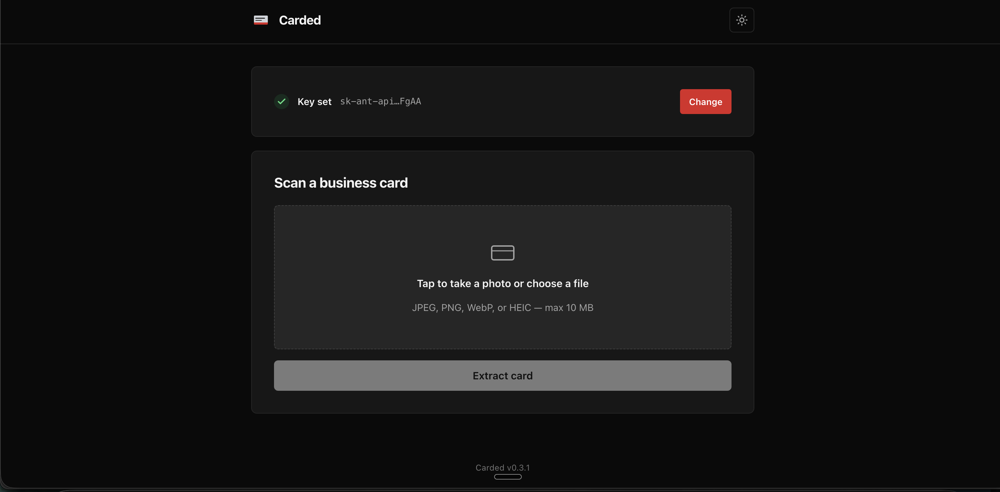

# Carded

Carded scans a business card image and extracts structured contact information using Claude's vision model (via BAML). Extracted data can be downloaded as a vCard (.vcf) for import into Apple Contacts, Google Contacts, or any vCard-compatible app, or as a Google Contacts CSV.

**Live at [carded.onrender.com](https://carded.onrender.com/).** Custom domain cutover to `carded.io` deferred — see `.cursor/features/1-custom-domain-carded-io-cutover.md`.



## Quickstart

### Run locally

```bash
git clone <repo-url> && cd carded
cp .env.example .env          # fill in SESSION_SECRET (see .env.example for how to generate one)
pip install -r requirements.txt
baml-cli generate             # regenerate baml_client/ from baml_src/
uvicorn app:app --reload
```

Then open `http://localhost:8000` in your browser. You'll be prompted to enter your Anthropic API key before uploading a card. When you save it, choose how long Carded keeps it: **This session only** (cleared when the browser closes), **7 days** (default), or **Remember this device (90 days)**. The key is Fernet-encrypted in an HttpOnly cookie, and the server rejects any token older than 90 days regardless of the cookie's lifetime.

### Run in Docker

```bash
docker build -t carded .
SESSION_SECRET=$(python3 -c "from cryptography.fernet import Fernet; print(Fernet.generate_key().decode())")
DOWNLOAD_TOKEN_SECRET=$(python3 -c "import secrets; print(secrets.token_urlsafe(32))")
docker run --rm -p 8000:8000 \
  -e SESSION_SECRET="$SESSION_SECRET" \
  -e DOWNLOAD_TOKEN_SECRET="$DOWNLOAD_TOKEN_SECRET" \
  -e COOKIE_SECURE=false \
  carded
```

### Deploy

See `.cursor/docs/2-phase-5-deployment-runbook.md` for the Render + Cloudflare runbook.

## Command-line export

`scripts/card_to_vcf.py` runs the same local pipeline without the web server:
photo in, `.vcf` out.

```bash
python3 scripts/card_to_vcf.py path/to/card.heic --out-dir ~/Downloads
```

- Reads the API key from `OWNER_ANTHROPIC_API_KEY` in `.env` (falls back to an
  `ANTHROPIC_API_KEY` env var). The key is never printed.
- Accepts JPEG, PNG, WebP, and HEIC. Never overwrites an existing file; adds
  `-2`, `-3`, and so on instead.
- `--json` prints a machine-readable result. `--verbose` shows BAML's full
  prompt and response log, which contains card data, so it is off by default.
- Exit codes: `0` ok, `1` config or file error, `2` bad command-line usage,
  `3` not a card, `4` illegible, `5` unsupported image, `6` extraction failed,
  `130` interrupted (Ctrl-C).
- Extracted text is treated as untrusted (card images can carry prompt
  injection): control characters are neutralized before printing, each
  field prints on exactly one line (embedded breaks show as `⏎`), and the
  vCard builder escapes or strips line breaks so card text can't add extra
  vCard fields. This hardening lives in `vcard_builder.py`, so the web app
  gets it too.
- Without `--verbose`, BAML logging is forced to `error` (even if your shell
  sets `BAML_LOG`; `warn` still prints the full prompt when a call fails)
  and error tracebacks are hidden, so card data and request
  details stay out of the terminal. Files are created owner-only (`0600`).
  The script never overwrites an existing file and won't follow a symlink
  at the target filename (a symlinked `--out-dir` itself is followed).

## Git hooks

Hooks live in a tracked `.githooks/` directory, but git does not pick them up
automatically. Run this once per clone:

```bash
git config core.hooksPath .githooks
```

They block AWS account IDs, ARNs, access keys and private-key headers in staged
content, in filenames, and in the commit message. Until you run that line, a
fresh clone commits unprotected.

## Requirements

- Python 3.11+
- An Anthropic API key (BYOK — Carded never stores your key in plaintext)

## License

TBD
